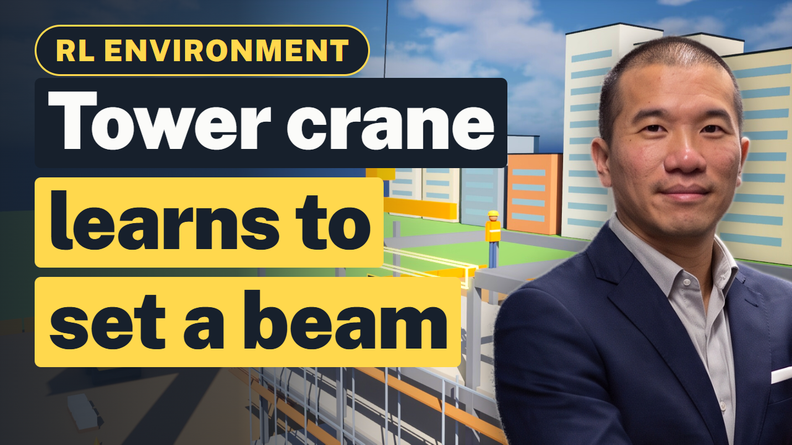

# Construction RL Environment in Unreal Engine: Tower Crane Lift Demo

A tower crane learns, by trial and error, to set the last steel beam into its slot on the top floor. First try: the beam lands on the frame. After practice: straight into place with zero hits.

This is an open **construction reinforcement learning (RL) environment** built in **Unreal Engine 5**: a tower crane lifting a steel beam
practises one job, every try is scored by a reward function, and the score teaches it what works. It covers
tower crane lift planning, load sway, collision avoidance and construction robotics. The full walkthrough is on YouTube ([Construction/Contracting AI RL Environment (Crane Lift Demo & Unreal Engine)](https://www.youtube.com/watch?v=n_BJqgVKKX0)), and the
[slides with the full transcript](https://aitrainingdatabroker.com/slides/rl-environment-tower-crane-construction/?utm_source=github&utm_campaign=rl-environment-tower-crane-construction-unreal) explain each step in plain words.

## What is an RL environment?

Reinforcement learning means software learns a job by trying, and every try gets a score. An RL environment is the
practice world where those tries happen: a task, many tries, and a reward function that grades each one. When the
world copies a real place closely enough, people also call it a digital twin or a simulator.

## The world

A construction site with a tower crane, a steel frame building, a ghost outline and a PLACE BEAM HERE sign marking the empty slot, beams waiting in a stack, workers, an excavator, a mixer truck, fences and a city behind.

## Reward function

| Event | Score |
|---|---|
| Beam moving toward the slot | points |
| Set in the slot | +20 |
| Hit the frame | -30 |
| Swing too wide | small cost |

## How it was built

The crane is a chain of pivots (slew, trolley, hook, beam) keyed on one Sequencer timeline; `gen_crane.py` computes each lift, including the sway of the hanging beam and a wind gust, and writes the keys.

The run is pre-programmed on a Sequencer timeline (`LS_Crane`) and rendered with Unreal's built-in sequence capture.
The scorecard is drawn afterwards in Python, so a text fix never needs a re-render.

## Why construction companies build RL environments

A private simulator lets a company practise a costly or risky job without touching real equipment: lift planning, operator training, and checking a lift before the crew does it for real.
What makes a simulator realistic is the company's own operating data: lift logs, site plans and CAD files, schedules and incident reports. That data can stay in-house
to train a private model, or be licensed to an AI lab after it is de-identified, with the contract setting the limits.
How that works for construction companies is explained at [AITrainingDataBroker.com](https://aitrainingdatabroker.com/sell/construction-companies/?utm_source=github&utm_campaign=rl-environment-tower-crane-construction-unreal).

## Quick start

1. Install Unreal Engine 5.8 from the Epic Games launcher and open `CraneRL.uproject`.
2. The project opens on `/Game/Construction/Lvl_Construction`. Open `Content/Construction/Film/LS_Crane` in Sequencer and press play.
3. To render it yourself, edit the paths at the top of `scripts/render.py` and run `python scripts/render.py preview`, then `full`.
   `scripts/overlay_*.py` draws the scorecard and cuts the clips with ffmpeg.

Everything in the world is built from Unreal Engine's basic shapes and our own materials (43 Unreal files),
so it opens without Marketplace packs or template content.

## More RL environment demos

- [Trucking RL Environment in Unreal Engine: Trailer Docking Demo](https://github.com/aitrainingdatabroker/rl-environment-trucking-trailer-docking-unreal)
- [Manufacturing RL Environment in Unreal Engine: Robot Arm Bin Picking Demo](https://github.com/aitrainingdatabroker/rl-environment-factory-robot-arm-unreal)
- [MLP in RL, Explained with a Grocery Store: Milk Reorder Demo in Unreal Engine](https://github.com/aitrainingdatabroker/mlp-rl-grocery-reorder-unreal)
- [Delivery Robot RL Environment in Unreal Engine: Sidewalk Pizza Delivery Demo](https://github.com/aitrainingdatabroker/rl-environment-delivery-robot-unreal)

## About

Made by [AI Training Data Broker](https://aitrainingdatabroker.com/?utm_source=github&utm_campaign=rl-environment-tower-crane-construction-unreal), a broker and technical advisor for companies licensing their
operating data to AI labs. Code and our own assets are MIT licensed (see `LICENSE`). The world is a demo built for
illustration: a production RL environment needs more training, testing and real operational data. General information,
not legal advice.
